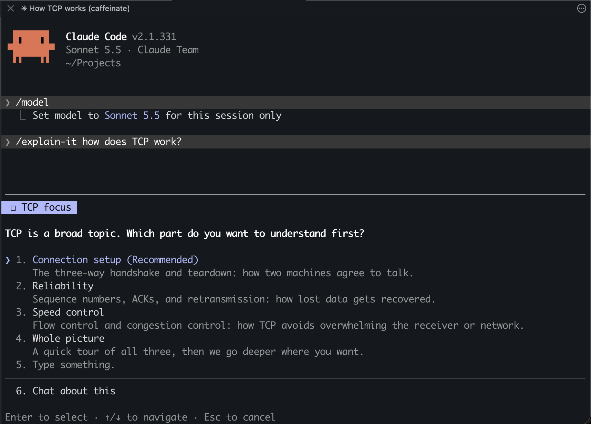
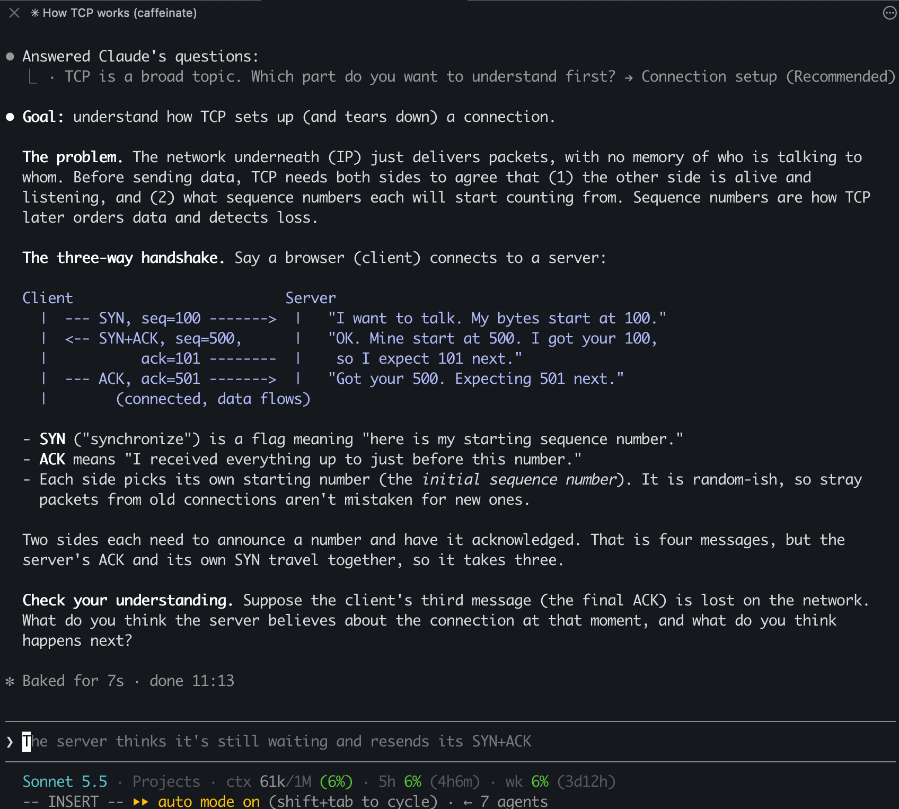

# Explain

Agent skills for learning technical things in one chat, for Claude Code and Codex.

When I try to learn something technical with AI, I usually hit two problems:

1. **Too much unnecessary text.**
2. **Oversimplification**, and analogies that lose the plot.

To address these, I now use `/explain-it`. It is inspired by Matt Pocock's `/teach` and Jane Street's `socratic-tutor`, with a focus on fast feedback and keeping everything in the chat.

## What explain-it does

**Less text**

- Short turns, one idea at a time.
- Starts right away when your request is clear, and asks only for what is missing.
- Stops at the goal you agreed on, with a brief takeaway. It does not automatically start another lesson.

**No lost plot**

- Explains through a small worked example tied to your question, and defines terms where they matter.
- Checks your reasoning with a prediction, "explain why", or changed-case question. A correct guess is not taken as proof you understand.
- Verifies uncertain facts with primary sources and cites them inline.

## How a session goes

1. **Clarify.** If your goal, background, or sticking point is unclear, it asks one question at a time in your agent's question picker (`AskUserQuestion` in Claude Code, `request_user_input` or `request_user_input_async` in Codex) and waits for your answer. A broad topic like "how does TCP work?" gets two or three directions to pick from.
2. **Explain.** One idea, through a small worked example.
3. **Check.** A small question, without giving away the answer.
4. **Adapt.** It keeps what you got right and corrects the specific part you missed. If you are stuck, it gives a hint, simplifies the step, changes the example, or teaches the missing piece.
5. **Finish.** At the agreed goal, with a takeaway and any gap still open.

Say "just explain" to skip practice, or "stop" to end. Everything stays in the chat: no files, folders, visuals, or resource lists. It explains your code without editing it.

## Example

`/explain-it how does TCP work?` in Claude Code. TCP is a broad topic, so it asks where to start:



After you pick, it states the goal, explains one idea through a worked example, and ends on a question that checks your reasoning:



## Install

Each skill is a folder with a `SKILL.md` in the [Agent Skills format](https://agentskills.io/specification).

```bash
git clone https://github.com/e1daru/Explain.git
cd Explain
python3 scripts/install.py
```

This copies `explain-it` into `~/.claude/skills/` (Claude Code) and `~/.agents/skills/` (Codex). Add `--host claude` or `--host codex` for just one. It will not overwrite a different existing copy. You can also copy `skills/explain-it/` into either folder yourself.

If you installed an earlier `explain` or `teach-it` folder, remove it to avoid duplicates.

Then start with `/explain-it` in Claude Code or `$explain-it` in Codex:

```text
/explain-it Help me understand why a lower Sun makes a longer shadow.
```

## textbook-it

Want a complete explanation in one response instead of a conversation? `textbook-it` starts from your goal and walks one worked example to the answer. When it helps, it picks a table, flow, or diagram using one of seven optional guides: state, process, quantities, contrast, space, structure, or derivation.

Install it with `python3 scripts/install.py --skill textbook-it`, then use `/textbook-it` or `$textbook-it`.

## Try it

[docs/explain-it-trials.md](docs/explain-it-trials.md) has test prompts and a feedback sheet. explain-it has not been through learner trials yet, so feedback is welcome.

## Credits

- **[Matt Pocock's teach](https://github.com/mattpocock/skills/blob/main/skills/productivity/teach/SKILL.md)** teaches a topic over multiple sessions in a persistent workspace: a `MISSION.md`, short HTML lessons, reference docs, learning records, and shared assets. explain-it borrows its goal-led teaching with practice and feedback, and keeps everything in one chat instead.
- **[Jane Street's socratic-tutor](https://github.com/janestreet/agent_skills/blob/main/socratic-tutor/SKILL.md)** is a strict Socratic tutor: a diagnostic, a 0 to 5 skill map, one question at a time, spaced review, and a final assessment for mastery. explain-it borrows its one-question-at-a-time checks (predict, explain why, apply to a new case), and works toward one agreed goal, then stops.
